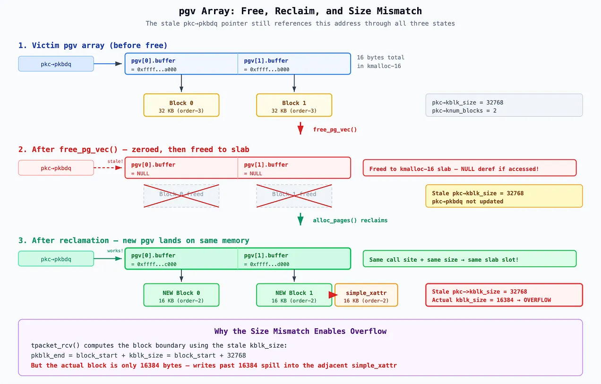

# CVE-2025-38617

**kernel exploitation**

[学习](https://blog.calif.io/p/a-race-within-a-race-exploiting-cve)

## 介绍

`CVE-2025-38617`是 Linux kernel 数据包套接字子系统中的一个`UAF`漏洞，由`packet_set_ring()`与`packet_notifier()`之间的`race condition`导致

它允许无特权本地攻击者实现完全的privilege escalation和container escape，只需具备`CAP_NET_RAW`，而该能力通过user namespace即可获得

## 背景

### Packet Sockets

Linux packet socket（`AF_PACKET`）在**链路层**提供对网络接口的原始访问

像大家耳熟能详的`tcpdump`，`Wireshark`等工具就是用它来捕获网络流量的

当一个数据包到达某个网络接口时，内核会通过已注册的协议钩子（hook）函数，把数据包副本投递给任意挂接到该接口上的`packet socket`

Packet socket的**生命周期**与网络接口状态绑定：

- 当接口为 UP 时，packet socket的hook被注册，socket进入`PACKET_SOCK_RUNNING`状态，此时它可以接收数据包

- 而当接口为 DOWN 时，hook被注销，socket停止接收数据包

这些状态转换由`packet_notifier()`管理，它处理`NETDEV_UP`和`NETDEV_DOWN`事件

### Ring Buffers and TPACKET_V3

为了高性能数据包处理，packet socket支持**内存映射环形缓冲区**

内核不再通过 recvmsg() 逐个复制数据包，而是把数据包直接写入一块共享内存区域，用户态便可以通过`mmap()`映射这块区域

环形缓冲区通过 setsockopt() 配置：

- 接收用 PACKET_RX_RING

- 发送则用 PACKET_TX_RING

其内部会调用`packet_set_ring()`

环形缓冲区由多个块（block）组成，每个块都是一段连续分配的内核页，这些块由一个`struct pgv`指针数组来跟踪：

```c
struct pgv {
    char *buffer;  // pointer to one block of pages
};
```

`alloc_pg_vec()`函数负责分配这个数组以及每个块：

```c

static struct pgv *alloc_pg_vec(struct tpacket_req *req, int order)
{
    unsigned int block_nr = req->tp_block_nr;
    struct pgv *pg_vec;
    pg_vec = kcalloc(block_nr, sizeof(struct pgv), GFP_KERNEL | __GFP_NOWARN);
    for (i = 0; i < block_nr; i++) {
        pg_vec[i].buffer = alloc_one_pg_vec_page(order);
    }
    return pg_vec;
}
```

当用户态对 packet socket 文件描述符调用 mmap() 时，内核的 packet_mmap() 处理函数会遍历 pgv 数组，把每个块的页映射到调用进程的虚拟地址空间中，形成一段连续区域

块 0 的页排在最前，接着是块 1 的页，依此类推

于是用户态便得到一个指向该内存区域的指针，其中偏移 0 是块 0 的起始，偏移 block_size 是块 1 的起始，等等

对该区域的读写直接落到支撑环形缓冲区的内核页上，没有系统调用开销

如你所见，这个映射只基于 mmap 时刻 pgv[N].buffer 所指向的内容，内核把每个 pgv 条目解析到其底层物理页，并把该页映射到用户态，因此，如果攻击者能把某个`pgv[N].buffer`指针覆写成任意内核地址，然后调用`mmap()`，内核就会把该地址处的页映射到用户态，从而让攻击者获得对任意内核内存的直接读写访问

**TPACKET_V3**是 packet socket 环形缓冲区协议的最新版本，它增加了一个块描述符结构（`tpacket_kbdq_core`），用于跟踪当前哪个块处于活动状态，下一个数据包头部应该写在哪里，以及何时关闭一个写满的块并切换到下一个

其关键字段包括：

- pkbdq：指向 pgv 数组（即环形缓冲区本身）的指针

- kactive_blk_num：当前活动块的索引

- nxt_offset：指向当前块内下一个数据包将被写入位置的指针

- kblk_size：每个块的大小

- knum_blocks：块的总数

- blk_sizeof_priv：每块私有区域的大小

每个块的内存布局以 tpacket_block_desc 头部开始（对齐后 48 字节），接着是 blk_sizeof_priv 字节的私有区域，然后才是实际的数据包数据区

私有区域由用户态通过传给 setsockopt(PACKET_RX_RING) 的 tpacket_req3 结构中的 tp_sizeof_priv 字段配置

内核在每个块起始处保留这块空间，且从不把数据包数据写入其中，它存在的目的是让用户态应用存储自己的每块元数据（例如自定义时间戳或统计信息）

数据包写游标（nxt_offset）被初始化为 `block_start + 48 + ALIGN(blk_sizeof_priv, 8)`，即跳过头部和私有区域

当一个数据包到达时，`tpacket_rcv()`被调用，它通过 pkbdq[kactive_blk_num].buffer 查找当前块，找到写位置（nxt_offset），复制数据包数据，并写入元数据头部

这个函数即漏洞中会访问已释放内存的函数

### Extended Attributes and simple_xattr

扩展属性（xattrs）是可以附加到文件和目录上的`name-value`对，提供超出标准文件属性（权限，时间戳等）的元数据

它们按命名空间组织，例如`security.*`用于 SELinux 标签和能力，`user.*`用于任意用户数据，`trusted.*`用于特权元数据等等

用户态通过三个系统调用与它们交互，setxattr() 创建或更新，getxattr() 读取，removexattr() 删除

大多数文件系统把 xattrs 存在**磁盘**上，但像 tmpfs 这样的内存文件系统没有磁盘后端，相反，tmpfs 使用 simple_xattr 基础设施把 xattrs 完全存在内核**内存**中，每个 xattr 由一个`struct simple_xattr`表示

xattrs被组织在一棵**红黑树**中：

```c
struct rb_node {
    unsigned long  __rb_parent_color;  // parent pointer + color bit
    struct rb_node *rb_right;
    struct rb_node *rb_left;
};  // 24 bytes

struct simple_xattr {
    struct rb_node rb_node;  // offset 0,  size 24 (tree node pointers)
    char *name;              // offset 24, size 8
    size_t size;             // offset 32, size 8  ← overflow target
    char value[];            // offset 40          (inline value)
};  // total header: 40 bytes
```

结构体开头的`rb_node`包含三个指针：`__rb_parent_color`（父指针，颜色位编码在最低位），`rb_right`和`rb_left`

它们指向同一棵红黑树中的其它`simple_xattr`节点

当用户态对 tmpfs 文件调用`setxattr("security.foo", value, size)`时，内核分配一个 simple_xattr，复制名称和值，并将其插入 inode 的集合中

当调用 getxattr() 时，内核遍历集合比较名称，找到匹配项后，从 value[] 复制 size 字节到用户态缓冲区

如果用户态缓冲区小于 size，内核则返回 ERANGE

simple_xattr 是理想的利用目标，原因如下：

- 可控分配大小，`kmalloc(header + value_size)`分配可以通过选择合适的 value_size 来引导到任意 slab 缓存或页阶，当 value_size = 8192 时，总分配（40 + 8,192 = 8,232 字节）由 order-2 页（16 KB）提供

- 可控内容，`value[]`数据完全由攻击者控制，名称字符串也由攻击者选择

- 可通过系统调用读写，getxattr() 从 value[] 开始读取 size 字节，如果 size 被损坏为更大的值，内核会读取超出对象实际数据的内容，泄露相邻堆内存，setxattr() 可以更新值，removexattr() 释放对象

- 通过节点指针泄露地址，`rb_node`指针包含树中相邻节点的内核地址，如果攻击者能读取这些指针，他们就能获知其它 simple_xattr 对象的内核地址

- 可喷洒，在单个 tmpfs 文件上创建数千个 xattrs 很简单，只需在循环中调用 setxattr() 并使用唯一名称即可

### Slab Allocator vs Page Allocator

Linux 内核有两层内存分配机制，理解它们之间的边界至关重要

Page Allocator（即buddy system）是底层，它以 2 的幂次页块管理物理内存：order-0（4 KB），order-1（8 KB），order-2（16 KB），依此类推

每次分配都是页对齐的，当页被释放时，相邻的同 order 空闲页会合并（`buddy`）成更高 order 的块

关键在于，页分配器不按类型隔离，所有 order-2 页都来自同一个空闲链表，一个来自 simple_xattr 值的已释放 order-2 页，可以被另一个 order-2 的 pgv 数组分配回收，页分配器不知道也不关心这些页被用于什么

slab 分配器（现代内核上是 SLUB）位于page allocator之上，它从buddy system请求页，并将其切分为固定大小的槽位，用于小对象

它有通用大小类（kmalloc-8，kmalloc-16，kmalloc-8k等等）以及针对特定结构体类型的专用缓存

与page allocator不同，slab 缓存是隔离的，一个已释放的 kmalloc-192 槽位会返回到其特定缓存，并且只能被另一个 kmalloc-192 分配回收

这个边界也正是我们强制某些分配超过 kmalloc-8k（最大的通用 slab 桶）的原因

一个 8,200 字节的 pgv 数组无法放入 kmalloc-8k，因此分配器会落到 page allocator，而我们的 heap grooming 便是在此控制哪些已释放页会被回收

如果该分配仍留在 slab 内，已释放的 xattr 页和 pgv 数组将位于完全不同的缓存中，无法互相回收

### Kernel Heap Mitigations

kernelCTF 环境启用了两项现代 heap mitigations，使传统的 cross cache attack 变得十分困难

**CONFIG_RANDOM_KMALLOC_CACHES**

其为每个 kmalloc 大小类引入 16 个独立的 slab 缓存（例如 kmalloc-rnd-01-32，kmalloc-rnd-02-32 ... kmalloc-rnd-16-32）

当内核调用 kmalloc() 时，分配会根据调用点地址与每次启动随机种子的哈希值，被路由到这 16 个缓存之一

其目标是防止攻击者预测某次分配会落入哪个缓存，从而破坏经典利用模式：从缓存 X 释放对象 A，并用来自同一缓存 X 的对象 B 回收它，由于 A 和 B 来自不同的调用点，它们很可能落入不同的随机缓存，回收就会失败

绕过方法也很简单，如果两个分配来自同一个调用点（调用 `kmalloc/kcalloc` 的同一行源代码），那么无论启动种子如何，它们总是哈希到同一个随机缓存

我们通过使用`alloc_pg_vec()`，同一个函数，同一个 kcalloc() 调用点，来同时分配受害环形缓冲区和回收环形缓冲区，从而利用这一点

两者都是通过`alloc_pg_vec()`内部的`kcalloc(block_nr, sizeof(struct pgv), ...)`分配的 pgv 数组，因此保证会落入同一个随机缓存

**CONFIG_SLAB_VIRTUAL**（即**virtual slab**）

其确保某一种 slab 缓存类型使用的虚拟地址范围永远不会被另一种 slab 缓存类型复用

在普通内核中，已释放的 slab 页可以返回 page allocator，并被重新分配给完全不同的 slab 缓存，从而允许 cross cache attack

启用**CONFIG_SLAB_VIRTUAL**后，每个缓存都会获得专用的虚拟地址范围，来自 kmalloc-64 的分配将始终映射到 kmalloc-64 的虚拟地址，即使在被释放并重新分配之后也是如此

如果攻击者释放一个 kmalloc-64 对象并试图用 kmalloc-128 对象回收它，虚拟地址将不会重叠

绕过方法遵循同样的原则：通过用另一个环形缓冲区（相同对象类型，相同 slab 缓存）回收已释放的环形缓冲区内存，虚拟地址仍然有效

我们不需要 cross cache attack，自始至终使用环形缓冲区来回收环形缓冲区即可

这些heap mitigations迫使我们每次回收都必须使用来自同一调用点的相同对象类型

正如我们即将看到的，这一约束塑造了整个利用程序的架构，从使用 TX 环形缓冲区回收 RX 环形缓冲区，到喷洒 pgv 数组以回收其它 pgv 数组

## 漏洞

### bug

漏洞的根因是`packet_set_ring()`中的一个logic error：当重新配置环形缓冲区时，该函数需要临时将数据包套接字从网络接口上解除挂接，以确保在环形缓冲区被替换期间没有数据包到达，以下是相关代码：

```c
static int packet_set_ring(struct sock *sk, union tpacket_req_u *req_u,
        int closing, int tx_ring)
{
    // ...
    spin_lock(&po->bind_lock);
    was_running = packet_sock_flag(po, PACKET_SOCK_RUNNING);
    num = po->num;
    if (was_running) {
        WRITE_ONCE(po->num, 0);    // Only zeroed if was_running!
        __unregister_prot_hook(sk, false);
    }
    spin_unlock(&po->bind_lock);

    synchronize_net();

    mutex_lock(&po->pg_vec_lock);
    // ... swap ring buffers, free old ring ...
    mutex_unlock(&po->pg_vec_lock);

    spin_lock(&po->bind_lock);
    if (was_running) {
        WRITE_ONCE(po->num, num);   // Only restored if was_running!
        register_prot_hook(sk);
    }
    spin_unlock(&po->bind_lock);
}
```

关键点在于围绕`WRITE_ONCE(po->num, 0)`的`if (was_running)`条件判断

po->num 字段决定该套接字注册的协议号，当它非零时，`packet_notifier()`中的`NETDEV_UP`处理程序会重新注册协议钩子：

```c
case NETDEV_UP:
    if (dev->ifindex == po->ifindex) {
        spin_lock(&po->bind_lock);
        if (po->num)                    // <-- checks po->num
            register_prot_hook(sk);     // re-hooks the socket!
        spin_unlock(&po->bind_lock);
    }
    break;
```

漏洞便位于此处，如果在调用 packet_set_ring() 时数据包套接字当前并未处于运行状态，那么 po->num 会保留其原始的非零值

在 spin_unlock(&po->bind_lock) 之后，存在一个race window，此时 packet_set_ring() 已释放绑定锁，但尚未完成环形缓冲区的重新配置

如果在这个窗口期内到达一个 NETDEV_UP 事件，packet_notifier() 会看到 `po->num != 0` 并调用 register_prot_hook()，将该套接字重新挂接到网络接口上

此时此刻，packet_set_ring() 正处在释放并替换环形缓冲区的过程中，而该套接字却仍然能够接收数据包

### The Race Window and UAF

我们通过一个two-race sequence触发该漏洞

#### Race 1: packet_set_ring() vs packet_notifier()

首先，攻击者确保数据包套接字已绑定到网络接口但未运行（接口处于 DOWN 状态）

随后调用 packet_set_ring() 释放现有的 RX 环形缓冲区

在 packet_set_ring() 释放 bind_lock 之后，获取 pg_vec_lock 之前，将接口置为 UP

packet_notifier() 看到 po->num != 0，重新注册协议钩子

此时套接字已“运行”，可以接收数据包，尽管 packet_set_ring() 尚未完成

#### Race 2: packet_set_ring() vs tpacket_rcv()

现在钩子已注册，向接口发送数据包会触发 tpacket_rcv()

该函数读取环形缓冲区元数据（`prb_bdqc`），而该元数据仍指向旧环形缓冲区，与此同时，packet_set_ring() 继续在 pg_vec_lock 临界区内释放同一个环形缓冲区：

```c
mutex_lock(&po->pg_vec_lock);
    swap(rb->pg_vec, pg_vec);     // pg_vec now holds old ring buffer
    // ...
mutex_unlock(&po->pg_vec_lock);
// ...
free_pg_vec(pg_vec, order, req->tp_block_nr);  // free the old ring!
```

如果 tpacket_rcv() 在环形缓冲区被释放后访问它，我们就有了一个 UAF 原语

TPACKET_V3 的 prb_bdqc 结构体对我们的利用来说特别关键，因为其指向环形缓冲区的指针（pkbdq，nxt_offset，pkblk_start等等）在环形缓冲区被释放时不会被清零

已释放的 pg_vec 数组会由 free_pg_vec() 将各个缓冲区指针置为 NULL，但 prb_bdqc 却仍持有过期的旧地址

## Key Insight

如果你能让互斥锁（mutex）持有者睡眠，你就能将任意一次锁释放与后续锁获取之间的时间窗口拉长到任意时长

在 packet_set_ring() 中，释放 bind_lock 与获取 pg_vec_lock 之间存在一个关键间隙：

```c
spin_unlock(&po->bind_lock);    // Race 1 window opens
synchronize_net();
mutex_lock(&po->pg_vec_lock);   // Race 1 window closes
```

正常情况下，synchronize_net() 很快完成，mutex_lock() 也立即成功，使得这个窗口非常短暂

但 pg_vec_lock 互斥锁也会被 tpacket_snd() 获取：

```c
static int tpacket_snd(struct packet_sock *po, struct msghdr *msg)
{
    mutex_lock(&po->pg_vec_lock);       // 持有互斥锁
    // ...
    timeo = wait_for_completion_interruptible_timeout(
        &po->skb_completion, timeo);    // 持有期间睡眠！
    // ...
    mutex_unlock(&po->pg_vec_lock);
}
```

我们通过在受害套接字的 TX 环形缓冲区上调用 sendmsg()，并使其到达 wait_for_completion_interruptible_timeout()，来预先获取 pg_vec_lock

这会让线程在持有互斥锁的情况下睡眠一段可配置的时长（通过 SO_SNDTIMEO 设置）

现在 packet_set_ring() 会在 mutex_lock(&po->pg_vec_lock) 处阻塞一段可预测的，由攻击者控制的时间，在本例中为整整一秒

这将一个纳秒级的竞态窗口转变为一个一秒级的窗口，使得第一个竞态基本变成确定性的：我们有充足的时间将网络接口置为 UP 并注册协议钩子

这一模式其实很具有**普适性**，在审计内核代码中的竞态条件时，寻找以下情况：

- 存在一个序列：锁 A 被释放，执行一些工作，然后锁 B 被获取

- 存在另一条代码路径，它持有锁 B 并且可以睡眠（互斥锁允许睡眠，而自旋锁不允许）

- 有一种方法可以在竞态代码路径之前触发那条睡眠的代码路径

如果这三个条件都满足，那么从释放锁 A 到获取锁 B 之间的竞态窗口就可以被任意拉长

那些因为窗口很小而看似足够安全的代码，就会变得轻而易举地被利用

## exploit

### Stage 0: Winning the Races

#### First Race: Deterministic via Mutex Barrier

##### How tpacket_snd() holds pg_vec_lock while sleeping

注意，这并不是传统意义上两个线程赛跑，希望靠运气赢的那种竞态，我们通过把 mutex 当作屏障，把随机性完全消除，将其转换成确定性的执行序列

因此，我们需要一种方法，在可控时长内持有 pg_vec_lock 这个 mutex

相关代码路径如下：

```c
static int tpacket_snd(struct packet_sock *po, struct msghdr *msg)
{
    bool need_wait = !(msg->msg_flags & MSG_DONTWAIT);  // [1] controllable

    mutex_lock(&po->pg_vec_lock);                        // [2] grab the mutex

    // ... validate device is UP, etc ...

    do {
        ph = packet_current_frame(po, &po->tx_ring, TP_STATUS_SEND_REQUEST);
        if (unlikely(ph == NULL)) {
            if (need_wait && skb) {                      // [3] need skb != NULL
                timeo = sock_sndtimeo(&po->sk, ...);    // from SO_SNDTIMEO
                timeo = wait_for_completion_interruptible_timeout(
                    &po->skb_completion, timeo);         // [4] SLEEP here!
                if (timeo <= 0) {
                    err = !timeo ? -ETIMEDOUT : -ERESTARTSYS;
                    goto out_put;
                }
            }
            continue;
        }

        skb = NULL;
        tp_len = tpacket_parse_header(po, ph, ...);     // [5] read from TX ring
        if (tp_len < 0) goto tpacket_error;

        skb = sock_alloc_send_skb(&po->sk, ...);        // [6] after this, skb != NULL

        tp_len = tpacket_fill_skb(po, skb, ...);        // [7] can force tp_len < 0
        if (unlikely(tp_len < 0)) {
tpacket_error:
            if (packet_sock_flag(po, PACKET_SOCK_TP_LOSS)) {  // [8]
                __packet_set_status(po, ph, TP_STATUS_AVAILABLE);
                packet_increment_head(&po->tx_ring);
                kfree_skb(skb);
                continue;                                // [9] loop again!
            }
        }
        // ...
    } while (...);

out:
    mutex_unlock(&po->pg_vec_lock);                      // [10] finally release
}
```

具体利用方式如下：

- 调用 sendmsg() 时不带 MSG_DONTWAIT，于是 need_wait = true

- 在 [2] 获取 mutex

- 第一次循环迭代：找到一个 TX frame（我们已通过 mmap() 预写 TP_STATUS_SEND_REQUEST），在 [5]，tpacket_parse_header() 从 mmap 的 ring 中读取 tp_len，我们设置 tp_len = 1，这个值太小，导致 [7] 的 tpacket_fill_skb() 返回负错误，但在此之前，[6] 的 sock_alloc_send_skb() 已让 skb != NULL

- PACKET_SOCK_TP_LOSS 标志已设置（通过 setsockopt(PACKET_LOSS)），所以走到 [8] -> [9]，继续回到循环顶部

- 第二次循环迭代：没有更多带 TP_STATUS_SEND_REQUEST 的 frame，所以 ph == NULL，此时 need_wait == true 且 skb != NULL（来自第一次迭代的分配），于是进入 [3] -> [4]：wait_for_completion_interruptible_timeout()，线程在持有 pg_vec_lock 的情况下睡眠 SO_SNDTIMEO 时长（1 秒）

但是有一个细节需要注意，sock_alloc_send_skb() 会检查 sk->sk_err，如果已设置就返回 NULL

当接口变为 DOWN 时，packet_notifier() 会设置 sk->sk_err = ENETDOWN，由于稍后需要接口 DOWN 来触发 bug，我们必须确保 tpacket_snd() 运行时接口仍然是 UP，顺序很重要

##### The deterministic sequence

exp需要运行在用户命名空间（以获取 `CAP_NET_RAW`）和网络命名空间（以获得受控网络环境）中

我们通过 netlink（RTM_NEWLINK，IFLA_INFO_KIND = "dummy"）创建一个名为 pwn_dummy 的 dummy 网络接口，把 MTU 设为 IPV6_MIN_MTU - 1（1279 字节），并通过 ioctl(SIOCSIFFLAGS, IFF_UP | IFF_RUNNING) 将其置为 UP

dummy 接口是理想选择，因为它是纯软件设备，发往它的数据包会立即回环到协议处理函数，所以不需要任何真实硬件或网络流量

然后我们创建 victim packet socket，一个绑定到该 dummy 接口的 AF_PACKET/SOCK_RAW socket，sll_protocol = htons(ETH_P_ALL)（接收所有协议类型），该 socket 配置了 TPACKET_V3 环形缓冲区（TX 和 RX 都有），启用 PACKET_LOSS，SO_SNDTIMEO 设为 1 秒，PACKET_RESERVE 设为 38，并附加了一个 700 条指令的 BPF filter，RX ring 就是竞态期间会被释放的那个，TX ring 则提供 tpacket_snd() 睡眠技巧所需的 frame，此时，victim socket 处于 UP 状态并正在积极收包，这正是漏洞利用所需的起始状态

随后我们创建三个 worker 线程：

- pg_vec_lock_thread（CPU 0，nice = 19，最低优先级）：持有 mutex

- pg_vec_buffer_thread（CPU 0，正常优先级）：运行 packet_set_ring() 释放 ring buffer

- tpacket_rcv_thread（CPU 1）：发送触发 UAF 的数据包

pg_vec_buffer_thread 在同一 CPU 上优先级高于 pg_vec_lock_thread，这对第二场竞态的时序至关重要，两个线程都固定到 CPU 0，所以同一时间只能运行一个

当 pg_vec_lock_thread 中的 tpacket_snd() 调用 mutex_unlock(&po->pg_vec_lock) 时，**CFS**（完全公平调度器，Linux 默认进程调度器，按优先级比例分配 CPU 时间）看到被唤醒的 pg_vec_buffer_thread（nice=0）优先级高于正在运行的 pg_vec_lock_thread（nice=19，最低可能优先级），于是立即抢占它，这意味着 packet_set_ring() 会无延迟地恢复，它释放旧 ring buffer 的页，同一线程立即用 alloc_pages() 重新回收这些页，这很重要，因为在 CPU 1 上，tpacket_rcv() 正被定时器中断冻结，而该冻结时长有限，CPU 0 上整个**释放并回收**序列必须在 CPU 1 的中断返回之前完成，如果 pg_vec_lock_thread 在 mutex 释放后继续运行（把 CPU 0 时间浪费在无关的清理上），回收可能来不及完成，导致 NULL dereference crash，而不是受控的 UAF

exp按步骤进行：

Step 1：锁定 mutex，主线程向 pg_vec_lock_thread 发送工作，它调用 sendmsg() -> 进入 tpacket_snd() -> 获取 po->pg_vec_lock -> 到达 wait_for_completion_interruptible_timeout() -> 睡眠，主线程轮询 /proc/[tid]/stat 直到线程状态为 S（睡眠），然后用 clock_gettime(CLOCK_MONOTONIC) 记录 pg_vec_lock_acquire_time

Step 2：将接口置为 DOWN，主线程调用 ioctl(SIOCSIFFLAGS) 把接口设为 DOWN，这会触发 packet_notifier() 的 NETDEV_DOWN，它摘除 victim socket 的钩子（设置 PACKET_SOCK_RUNNING = false），socket 不再运行，但 po->num 仍非零

Step 3：触发 packet_set_ring()，主线程向 pg_vec_buffer_thread 发送工作，它调用 setsockopt(PACKET_RX_RING, {tp_block_nr=0})，这进入 packet_set_ring() 的释放路径：

- spin_lock(&po->bind_lock)

- was_running = false （interface is **DOWN**）

- num = po->num （non-zero -> this is the bug）

- if (was_running) is false -> **po->num is NOT zeroed**

- spin_unlock(&po->bind_lock) （the race window opens）

- synchronize_net() （brief wait）

- mutex_lock(&po->pg_vec_lock) （**BLOCKS** because pg_vec_lock_thread holds it）

主线程轮询 /proc/[tid]/stat 直到 pg_vec_buffer_thread 处于睡眠，这确认 packet_set_ring() 已经过了有漏洞的 bind_lock 段，现在阻塞在 mutex 上

Step 4：将接口置为 UP，主线程调用 ioctl(SIOCSIFFLAGS) 把接口设为 UP，这会触发 packet_notifier() 的 NETDEV_UP：

```c
case NETDEV_UP:
    spin_lock(&po->bind_lock);
    if (po->num)                  // non-zero — the bug!
        register_prot_hook(sk);   // re-hooks the socket!
    spin_unlock(&po->bind_lock);
```

**The first race is won**

victim socket 现在重新挂到接口上，它将通过 tpacket_rcv() 收包，但 packet_set_ring() 被冻结在 mutex 上，等待释放旧 ring buffer

#### Second Race: Probabilistic but Enhanced with Three Timing Mechanisms

赢下第一场竞态后，当前状态：

- victim socket 已经重新挂到网络接口上（通过 tpacket_rcv() 收包）

- packet_set_ring() 被冻结，阻塞在 po->pg_vec_lock 上，而该锁由正在睡眠的 pg_vec_lock_thread 持有

- pg_vec_lock_thread 将在恰好 1 秒后醒来（SO_SNDTIMEO 超时）

当超时到期，pg_vec_lock_thread 释放 mutex 后，packet_set_ring() 恢复执行，在 pg_vec_lock 临界区内，它做两件事：

- 把 rb->pg_vec 交换为 NULL

- 把协议hook函数从 tpacket_rcv 改成 packet_rcv，释放 mutex 后，它调用 free_pg_vec() 释放旧 ring buffer 的页

**这个hook切换正是第二场竞态必要的原因**

一旦 packet_set_ring() 把hook切到 packet_rcv，任何新到达该 socket 的数据包都会被派发给 packet_rcv() 而不是 tpacket_rcv()，而 packet_rcv() 根本不用 ring buffer，所以不会 UAF，我们不能简单地等到 ring buffer 被释放后再发包，到那时hook已经被改掉了

让 tpacket_rcv() 访问已释放内存的唯一办法便是让它在hook被改之前就已经被派发，**网络栈**在数据包派发时解析hook函数指针，如果一个数据包被发到接口，并且 tpacket_rcv() 在 packet_set_ring() 交换hook之前就被调用，那么 tpacket_rcv() 会继续执行它的代码路径，包括访问 ring buffer，不管 packet_set_ring() 之后做什么，函数已经在调用栈上了，hook指针交换只影响未来的数据包

所以第二场竞态要做的比较微妙，我们要让 tpacket_rcv() 在 packet_set_ring() 改hook之前就被派发，却要在 packet_set_ring() 已经释放 ring buffer 页之后才去解引用这些页

**我们利用三种独立的时序机制叠加在一起，来命中这个微妙的窗口**

##### Mechanism 1: Calculated Sleep

由于我们精确知道互斥锁将在何时释放：

```c
pg_vec_lock_release_time = pg_vec_lock_acquire_time + sndtimeo  // +1 second
```

因此我们可以精准控制 tpacket_rcv_thread 在互斥锁释放前约 5 微秒醒来，并立即通过 packet_sendmsg_spkt() 发送数据包：

```c
// In tpacket_rcv_thread_fn:
struct timespec sleep_duration = timespec_sub(
    remaining_time_before_pg_vec_lock_release,
    work->decrease_tpacket_rcv_thread_sleep_time  // 5000 ns = 5μs
);
syscall(SYS_nanosleep, &sleep_duration, NULL);
syscall(SYS_sendmsg, trigger_sendmsg_packet_socket, work->msg, 0);
```

选择它是因为从 sendmsg() 到 dev_queue_xmit() 再到协议hook的代码路径最短

该数据包遍历网络栈，并最终到达 victim socket 上的 tpacket_rcv()

##### Mechanism 2: BPF Filter Delay

一个包含 700 条指令的经典 BPF filter 被附加到 victim socket 上：

```c
struct sock_filter filter[700];
for (int i = 0; i < 699; i++) {
    filter[i].code = BPF_LD | BPF_IMM;
    filter[i].k = 0xcafebabe;          // load immediate — cheap but not free
}
filter[699].code = BPF_RET | BPF_K;
filter[699].k = sizeof(size_t);        // return truncated length = 8 bytes
```

当数据包到达并调用 tpacket_rcv() 时，它会在执行早期，在接触 pkc->pkbdq 或任何环形缓冲区指针之前，调用 run_filter()

该过滤器执行全部 700 条指令，消耗 CPU 时间

在这个窗口期内，CPU 0 得以运行 packet_set_ring()，释放环形缓冲区并回收它

最后的 BPF_RET 指令还有第二个用途：它将数据包的**快照长度**截断为恰好 8 字节（即 sizeof(void *)），这正是我们希望在溢出目标中覆写的字节数

##### Mechanism 3: Timer Interrupt Lengthening

单靠 BPF filter 只能争取到微秒级时间，漏洞利用需要把 CPU 1 上的 tpacket_rcv() 暂停久得多，久到 CPU 0 上的 packet_set_ring() 不仅能释放 ring buffer，还能让回收分配完成，**这就是定时器中断技术登场的地方**

> [!NOTE]
> 
> `timerfd，epoll 和等待队列`
>
> `timerfd_create()` 系统调用创建一个文件描述符，用于投递定时器到期通知
> 
> 内核内部会分配一个 `timerfd_ctx` 结构，包含一个 hrtimer（高分辨率定时器）和一个 wait_queue_head（wqh）
> 
> 当定时器触发时，内核的 hrtimer 中断处理函数调用 timerfd_tmrproc() 以唤醒 wqh 上的所有等待者
>
> epoll 子系统即把等待者加到 wqh 上的途径
> 
> 当你调用 epoll_ctl(EPOLL_CTL_ADD) 来监控一个 timerfd 时，内核会调用 ep_ptable_queue_proc()
> 
> 它会分配一个 wait_queue_entry，并通过 add_wait_queue() 把它加到 timerfd 的 wqh 上
> 
> 对指向同一个 timerfd 的不同文件描述符，每调用一次 epoll_ctl()，就向这个等待队列多加一个条目
> 
> 所以一个 timerfd 可以通过 epoll 监控它的许多 dup() 副本，累积出任意长的等待队列
>
> 当定时器触发时，中断处理函数必须在 `spin_lock_irqsave` 下遍历整个等待队列
> 
> 这意味着**中断被禁用**，CPU 在每个条目处理完之前无法被抢占，这就把等待队列长度变成了可控的 CPU 停顿时长

在 kernelCTF 环境中，每个进程限制为 4096 个文件描述符（RLIMIT_NOFILE），我们先通过 setrlimit() 把 rlim_cur 提升到 rlim_max（4096）

但即便如此，4096 个等待队列条目也不足以把 CPU 停顿到所需时长，因此，我们选择通过创建 180 个线程来绕过这个限制，每个线程拥有自己私有的文件描述符表

**设置阶段**

初始化期间，我们创建 180 个 timerfd_waitlist_thread 线程，每个线程：

- 固定到 CPU 1（与 tpacket_rcv_thread 同一个 CPU）

- 调用 unshare(CLONE_FILES) 获得自己私有的文件描述符表，这是把 FD 上限放大的关键技巧，因为每个线程现在都有自己独立的 4096 个槽位

- 关闭 stdin，stdout，stderr 以腾出三个额外槽位

- 创建一个 epollfd（占用一个槽位）

- 循环调用 dup(timerfd) 直到 FD 表满，原始 timerfd（由主线程在 unshare 之前创建）仍然可访问，每次 dup() 创建一个指向同一个底层 timerfd_ctx 的新文件描述符

- 对每个复制出的 FD 调用 epoll_ctl(EPOLL_CTL_ADD)，为每一个向 timerfd 的 wqh 添加一个等待队列条目

每次 epoll_ctl() 调用都通过 ep_ptable_queue_proc() -> add_wait_queue() 向 timerfd 的内部等待队列添加一个 wait_queue_entry

`180 个线程 × 每线程约 4000 个 FD ≈ 720000 个条目`，累积到 timerfd 的等待队列上，停顿时长十分可观

**触发阶段**

由于 timerfd_settime() 把 hrtimer 绑定到调用它的 CPU 上，所以我们要在 CPU 1 上安装定时器：

```c
struct itimerspec settime_value = {};
settime_value.it_value = timespec_add(pg_vec_lock_release_time,
                                       timer_interrupt_amplitude);  // +150μs
timerfd_settime(timerfd, TFD_TIMER_ABSTIME, &settime_value, NULL);
```

当定时器在 CPU 1 上触发时，内核中断处理函数执行：

```c
timerfd_tmrproc()
  → timerfd_triggered()
    → spin_lock_irqsave(&ctx->wqh.lock, flags)   // interrupts disabled!
    → wake_up_locked_poll()
      → __wake_up_common()                         // walks the waitqueue
        → list_for_each_entry_safe_from(...)       // 720,000 entries!
          → ep_poll_callback()                     // called for each entry
    → spin_unlock_irqrestore(...)
```

`__wake_up_common()` 函数遍历全部 720000 个等待队列条目，对每个条目调用 ep_poll_callback()，整个循环在 spin_lock_irqsave 内运行，意味着中断被禁用，抢占不可能发生，如果定时器触发时 tpacket_rcv() 正在 CPU 1 上执行，它会完全冻结，直到中断处理函数走完整个列表，这需要数百微秒到毫秒，足够 CPU 0 上的 packet_set_ring() 释放 ring buffer，并让 pg_vec_buffer_thread 用新的 ring buffer 回收它

如果竞态输了（我们通过检查溢出是否真的损坏了目标对象来检测），exp则会重试整个序列

**实践中，精确睡眠时序，BPF filter 延迟和定时器中断技术这三者结合，提供了很高的成功率**

### Stage 1: Page Overflow Primitive (via xattr corruption)

赢下两场竞态后，当务之急是要把 UAF 变成有用的东西

这个阶段分为三部分：回收已释放的 ring buffer 以防止内核crash，spray堆布局使被回收的 buffer 与 victim 对象相邻，以及构造一次精确的溢出，恰好破坏我们想要改写的字段

#### Part 1: Reclaiming the freed pgv array

free_pg_vec() 在释放后会把 pgv 数组里所有 buffer 指针清零：

```c
static void free_pg_vec(struct pgv *pg_vec, unsigned int order, unsigned int len)
{
    for (i = 0; i < len; i++) {
        if (pg_vec[i].buffer) {
            free_pages((unsigned long)pg_vec[i].buffer, order);
            pg_vec[i].buffer = NULL;  // zeroed!
        }
    }
    kfree(pg_vec);
}
```

如果 tpacket_rcv() 读到一个被清零的 buffer 指针，它会触发 NULL dereference，内核崩溃

我们必须在 tpacket_rcv() 通过 BPF filter 和定时器中断并访问它之前，回收已释放的 pgv 数组，在内存中用一个新的 pgv 数组替换它，而这个新数组需要包含有效的 buffer 指针

这由 pg_vec_buffer_thread 处理，它在 CPU 0 上与 packet_set_ring() 一起运行，packet_set_ring() 释放 victim 的 ring buffer 后，同一线程立即在另一个 packet socket 上分配新的 TX ring buffer：

```c
// In pg_vec_buffer_thread_fn:
// Step 1: Free victim RX ring
setsockopt(victim_fd, SOL_PACKET, PACKET_RX_RING, &free_req, sizeof(free_req));
// Step 2: Immediately reclaim with a new TX ring
alloc_pages(reclaim_socket, MIN_PAGE_COUNT_TO_ALLOCATE_PGV_ON_KMALLOC_16, PAGES_ORDER2_SIZE);
```

我们使用的 alloc_pages() 是一个辅助函数，它通过在 packet socket 上创建 TX ring buffer 来分配内核页，它调用 setsockopt(PACKET_TX_RING)，传入指定的 block 数量和 block 大小，触发内核中的 packet_set_ring() -> alloc_pg_vec()，同时分配一个 pgv 数组和请求数量的页块，对应的 free_pages() 辅助函数调用 setsockopt(PACKET_TX_RING) 并传入全零参数，触发释放路径，这给我们提供了对内核页分配和释放的精确控制，通过一个简单的用户态 API，每个 packet socket 可以持有一个 TX ring，创建或销毁该 ring 就会分配或释放我们所需大小的页

回收 ring 的块数与 victim 相同（2 个块，MIN_PAGE_COUNT_TO_ALLOCATE_PGV_ON_KMALLOC_16 = 2），所以 pgv 数组大小相同：kcalloc(2, sizeof(struct pgv)) = kcalloc(2, 8) = 16 字节，由于两项 heap mitigations，大小匹配至关重要

**CONFIG_RANDOM_KMALLOC_CACHES** 通过哈希调用点地址来选择 slab 缓存，两个 pgv 数组都由 alloc_pg_vec() 内同一个 kcalloc() 分配，所以它们哈希到同一个随机缓存，但这只有在它们也属于同一大小类时才成立：如果回收使用 4 个块（32 字节 -> kmalloc-32）而不是 2 个块（16 字节 -> kmalloc-16），它就会进入完全不同的 slab 缓存

**CONFIG_SLAB_VIRTUAL** 强制每个 slab 缓存获得专用的虚拟地址范围，一个被释放的 kmalloc-16 槽位只能被另一个 kmalloc-16 分配复用，相同调用点 + 相同大小 = 保证相同 slab 缓存 = 新 pgv 数组落在旧数组占据的精确内存上

下图展示了 pgv 数组的三种状态：释放前，释放后（已清零，危险）以及回收后（新块，更小尺寸），过期的 pkc->pkbdq 指针自始至终引用同一个内存地址：



在回收之前，过期指针会找到 NULL，内核会崩溃

回收之后，它找到的是有效指针，但指向的是更小的 16 KB 块，而非原来的 32 KB 块，正是这种尺寸不匹配实现了溢出：过期的 kblk_size = 32768 让 tpacket_rcv() 误以为每个块都是 32 KB，但实际块只有 16 KB，因此超过 16 KB 的写入会溢出到相邻内存

#### Part 2: Heap grooming for page layout

我们需要通过堆布局来实现两件事

1.强制 tpacket_rcv() 越过 Block 0 推进到 Block 1， Block 0 的陈旧 nxt_offset（写游标）指向旧的，已释放的 32KB 页，往那里写是不可控的，而 Block 1 会通过 prb_open_block() 获得一个全新的 nxt_offset，它指向真实的，已被回收的页

2.确保回收 Ring 的 Block 1 在物理上紧邻一个 simple_xattr，从 Block 1 发生的溢出必须溅射到受害者对象上，而不是随机内存中

为了强制走 Block 1 的路径，我们需要让 `__packet_lookup_frame_in_block()` 中的 `curr > end` 条件成立，这意味着陈旧的 nxt_offset（来自旧 Block 0）的内存地址必须高于 `new_block_0 + 32768`，同时，为了确保相邻性，回收 Ring 的块必须落在一个被 simple_xattr 对象密集填充的区域，我们通过一个精心设计的，分阶段的分配序列来实现这两点


